# Đối chiếu DescriptionAPI với phạm vi wedding-app

Ngày tổng hợp: 14/10/2026. Đây là tài liệu triển khai mobile được tổng hợp từ file người dùng cung cấp, không phải bằng chứng code đã hoàn tất, API đã chạy live hoặc CI đã đạt. Phần đầu hướng dẫn phạm vi wedding-app; phần cuối giữ toàn bộ nội dung nguồn để tra cứu, kể cả phần Web/Manager và lịch sử. Những đoạn prompt/chỉ thị trong nguồn được lưu như nội dung tham khảo, không tự động trở thành lệnh thực thi. Không thay code, API lock, cấu hình hay pipeline trong tác vụ tạo tài liệu này.

Nguồn mới mô tả backend `d257be8507dd83e9da73ac69605646a8fbcc7209`, `WEDDING-CONTRACT-3@3.0.0`, OpenAPI 218 operation, digest `6a8be82541ca2d8ce274f9817d10bcd300c91de2f5e734055cf9108b23db0915`. Các kết luận blocker trước đây dựa pin `0a77391…` không được áp dụng nguyên xi cho contract mới. Nâng pin/sinh type/đối chiếu capability là công việc triển khai tiếp theo, chưa được thực hiện bởi ba file Markdown này. Trạng thái backend NO_GO/provider-worker trong nguồn là trạng thái được tài liệu ghi nhận ngày 13/10, không phải kiểm tra live mới.

**File nguồn:** `C:\Users\Admin\Downloads\DescriptionAPI.docx`

**SHA-256 file Word:** `164f9d830d253df0ab67acd95e11a4d06d24fd5d49d0d78b6617c0ac450d4faf`

## Đọc nhanh

- [Yêu cầu và phạm vi mobile](01-mobile-srs.md)
- [Flow và tích hợp backend cho mobile](02-mobile-be-fe-handoff.md)
- [Đối chiếu DescriptionAPI và phần không áp dụng](03-description-api-review.md)
- [Bản chuyển nội dung nguồn đầy đủ](#noi-dung-nguon)

## Kết luận quan trọng

**Tài liệu này không khớp hệ thống wedding-app trong hai file FPT606.** Nội dung mô tả marketplace nội thất: Customer individual/business, Supplier retailer/workshop, Store/Portfolio, Category/Material/Product/Variant/Inventory và chat REST+STOMP/SockJS. Không có Booking/Couple/contract/deposit/Guest Group/invitation/billing của backend wedding. Giữ như tài liệu tham khảo nguyên nguồn, không dùng nó để sinh gateway/màn hình/tính năng wedding-app khi chưa xác nhận đúng dự án/contract.

## Các khác biệt không được trộn vào app cưới

| DescriptionAPI                                                      | Wedding theo FPT606                                          | Quyết định cho mobile                                            |
| ------------------------------------------------------------------- | ------------------------------------------------------------ | ---------------------------------------------------------------- |
| Public `/register`, customerType, Google login                      | Không signup công khai; Couple nhận workspace invitation     | Không thêm signup/Google/business profile từ file này            |
| JWT, `/api/auth/login`, `/refresh`15p; văn bản gõ `/refesh`         | Android sessions/rotate refresh, access10p                   | Không sửa auth gateway theo DescriptionAPI                       |
| Admin/Supplier/Customer                                             | Manager/Staff/Couple/Guest                                   | Không đổi role/authorization                                     |
| Product/Variant/Store stock, wood/category/portfolio                | Single restaurant, menu/service/print offerings              | Không tạo marketplace/tồn kho/chi nhánh                          |
| Product public image upload gồmGIF                                  | Wedding originalprivate jpeg/png/webp và publicderived asset | Không dùng endpoint/product upload hay whitelistGIF cho ảnh cưới |
| STOMP `/ws`, `/user/queue/messages`, `/app/conversations/{id}/send` | Inbox notification/FCM theo handoff wedding                  | Không tự thêm chat/STOMP/dependency hoặc thay FCM                |
| `/api` base và supplierownership                                    | Wedding `/api/v1`, UUID/revision/idempotency/capability      | Không ghép path/body giữa hai backend                            |

## Nội dung đã đọc và giữ lại

- Auth/register/verify/resend OTP/Google/forgot/reset/refresh/logout, Customerbusinessprofile.
- User/admin, supplier retailer/workshop và chi nhánh, portfolio, categorytree, materialwood.
- Tạo productdraft với variants rồi multipartupload từng ảnh, active/hiddenstatus; imageprimary/sortOrder/update/delete.
- StoreInventory keyed storeId+variantId, GET/POST/PATCHdelta/DELETE/aggregate, ownership hai lớp,409 duplicate/404missing/400negative.
- Conversation idempotent theoCustomer/Supplier; RESTlist/messages/read/presence; messagecontent≤5000 hoặc attachment; historycreatedAtDESC reverse; STOMPconnectHeaderBearer, emailprincipal, userqueue, echo/dedup, RESTfallback, pollingpresence30–60s.

Những mục này được ghi để bảo toàn thông tin file đã gửi, **không đánh dấu là task wedding**. Có thể học nguyên tắc upload file thật, phân biệt empty/loading/error, dedup message/ownership, nhưng không chuyển sang yêu cầu/API wedding nếu không có hợp đồng tương ứng. Google client ID trong nguồn là cấu hình của tài liệu này, không phải cấu hình được chốt cho wedding-app.

## Thông tin nằm trong 14 ảnh

Ảnh1: Authentication gồm `/api/auth/{verify-otp,reset-password,resend-otp,register,refresh,logout,login,google,forgot-password}`. Văn bản gõ `/refesh`, screenshot ghi `/refresh`: giữ cả hai và không tự đoán sửa API.
Ảnh2: GET/PUT/POST `/api/users/me/business-profile`.
Ảnh3: userdetail/update/delete/password/list/presence/me; ảnh4: suppliersstatus/me/list/create/detail/public.
Ảnh5: stores CRUD; ảnh6: supplierportfolio CRUD vàpublic; ảnh7: categories CRUD vàtree; ảnh8: materials CRUD.
Ảnh9: product CRUD/status/mine; ảnh10: variantCRUD; ảnh11: productimage URL/fileupload/list/update/delete/primary.
Ảnh12: bảng REST đối chiếu STOMP/WebSocket. Ảnh13: Client @stomp/stompjs + SockJS, connectHeaderAuthorizationBearer, subscribeuserqueue. Ảnh14: client.publish destination `/app/conversations/${conversationId}/send` và JSONcontent/attachmentUrl.

Toàn bộ 14 ảnh gốc được giữ dưới `assets/description-api/`, chèn đúng vị trí nguồn trong bản chuyển phía dưới. Đây là ảnh Swagger/code của dự án nội thất, không phải ảnh UI V0 mobile. Không cài dependency chat hay gọi endpoint từ các ảnh trong tác vụ này.

## Việc cần xác nhận

- [ ] Chủ tài liệu xác nhận DescriptionAPI thuộc dự án nào; nếu gửi nhầm, giữ trạng thái không áp dụng.
- [ ] Nếu có phần muốn áp dụng cho wedding, phải có scope/endpoint mới được BE xác nhận và artifactOpenAPI tương ứng.
- [ ] Không xem tài liệu này là bằng chứng wedding có publicsignup, chat, StoreInventory hay Googlelogin.

## Nội dung nguồn đầy đủ

Các mã B là thứ tự block trong XML Word, không phải trang PDF. Bản chuyển giữ văn bản và bảng theo thứ tự để đối chiếu; không giữ bố cục trang Word. Bảng rộng nên xem trong trình đọc Markdown có cuộn ngang. Phần Manager/Web và prompt mẫu ở đây là tham khảo, không mở rộng scope app.

**Nguồn B1**

Đăng ký/ Đăng nhập:

**Nguồn B2 — ảnh**

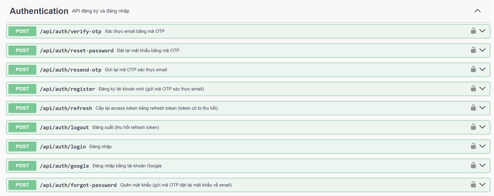

**Nguồn B3**

Đăng ký tài khoản:

**Nguồn B4**

/register: Dùng để tạo tài khoản cho customer.

**Nguồn B5**

/verify-otp: Gửi OTP về mail yêu cầu người dùng nhập OTP để xác thực email

**Nguồn B6**

/resend-otp: Gửi lại OTP

**Nguồn B7**

Lưu ý: Field customerType nhận giá trị individual nếu người dùng đăng ký tài khoản bình thường, nhận giá trị business cho chức năng tạo tài khoản business

**Nguồn B8**

Nếu business đăng nhập bằng google thì customerType mặc định sẽ là individual, lúc này phải cần api để update lên business + những thông tin của business

**Nguồn B9 — ảnh**

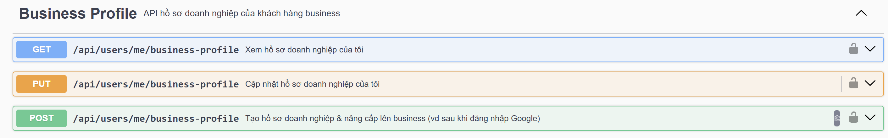

**Nguồn B10**

Đăng nhập: /login

**Nguồn B11**

Đăng nhập bằng mail + pass

**Nguồn B12**

Đăng nhập bằng google: /google

**Nguồn B13**

Để đăng nhập bằng google thì cả BE + FE phải cấu hình đúng GOOGLE_CLIENT_ID=124999965588-8d179djm0oh4go4iv51156ikhqg40jqm.apps.googleusercontent.com

**Nguồn B14**

Quên mật khẩu:

**Nguồn B15**

/forgot-password: nhập email -> gửi mail OTP về máy

**Nguồn B16**

/reset-password: nhập OTP -> nhập mật khẩu mới

**Nguồn B17**

Refesh token:

**Nguồn B18**

/refesh: Dùng để refesh lại token mỗi 15p, vòng đời của token sẽ dài hơn, không bắt người dùng đăng nhập lại nhiều lần

**Nguồn B19**

Đăng xuất:

**Nguồn B20**

/logout: Dùng để đăng xuất, vô hiệu hóa token

**Nguồn B21**

Quản lý người dùng:

**Nguồn B22 — ảnh**

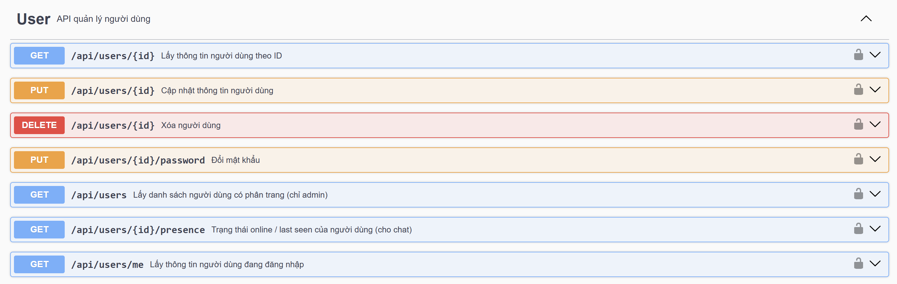

**Nguồn B23**

Cái này thì dễ rồi, có mô tả rầu

**Nguồn B24**

Luồng tạo supplier:

**Nguồn B25 — ảnh**

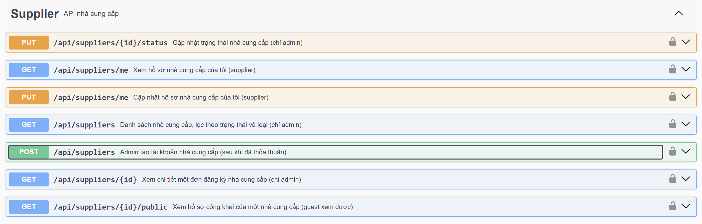

**Nguồn B26**

Admin tạo tài khoản supplier bằng POST /supplier -> mail tài khoản mật khẩu được gửi về -> đăng nhập lần đầu gọi api /users/{id}/password yêu cầu đổi mật khẩu

**Nguồn B27**

Lưu ý: Supplier được chia làm 2 loại: retailer (doanh nghiệp nội thất), workshop (xưởng sản xuất)

**Nguồn B28**

Supplier quản lý chi nhánh

**Nguồn B29 — ảnh**

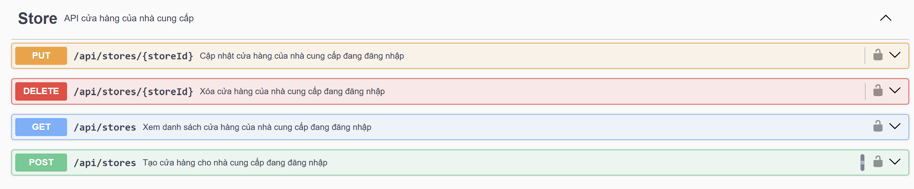

**Nguồn B30**

Doanh nghiệp nội thất có thể thêm nhiều địa chỉ (tức có nhiều chi nhánh)

**Nguồn B31**

Xưởng sản xuất chỉ có thể thêm 1 địa chỉ

**Nguồn B33**

Supplier quản lý portfolio

**Nguồn B34 — ảnh**

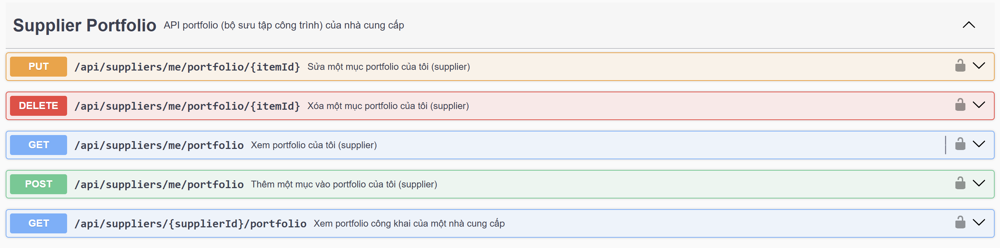

**Nguồn B35**

Retailer: có thể chọn sản phẩm của họ từ bảng product để them vào portfolio. Quy tắc lấy ảnh: lấy ảnh thumnail của sản phẩm được chọn

**Nguồn B36**

Workshop: không có catalog nên them portfolio bằng cách tải ảnh lên (gọi api upload ảnh để trả về url sau đó điền vào field imageUrl)

**Nguồn B37**

Admin tạo danh mục

**Nguồn B38 — ảnh**

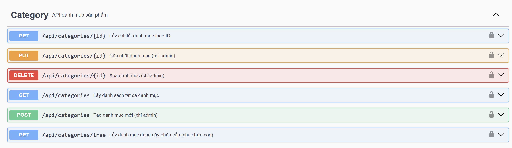

**Nguồn B39**

Danh mục có dạng cây phân cấp

**Nguồn B40**

Các danh mục phải được admin tạo để đồng bộ dữ liệu, không để supplier tạo vì sẽ có nhiều dữ liệu “rác”

**Nguồn B41**

Khi supplier them sản phẩm sẽ chọn danh mục cho sản phẩm từ thanh drop down

**Nguồn B42**

Hỗ trợ lọc filter sản phẩm theo danh mục ở marketplace

**Nguồn B43**

Admin tạo vật liệu gỗ

**Nguồn B44 — ảnh**

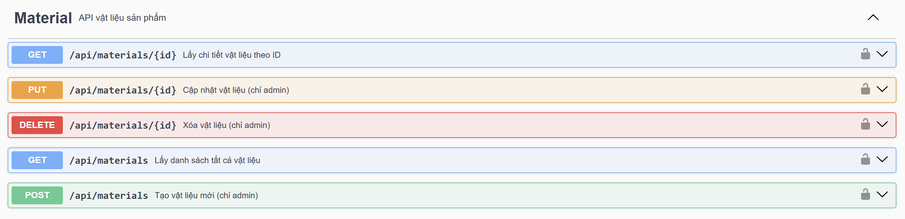

**Nguồn B45**

Admin sẽ them các loại gỗ trên thị trường, khi supplier them sản phẩm chỉ cần chọn chất liệu của sản phẩm từ thanh drop down.

**Nguồn B46**

Hỗ trợ lọc filter sản phẩm theo chất liệu ở martket place

**Nguồn B47**

Supplier them sản phẩm của họ:

**Nguồn B48 — ảnh**

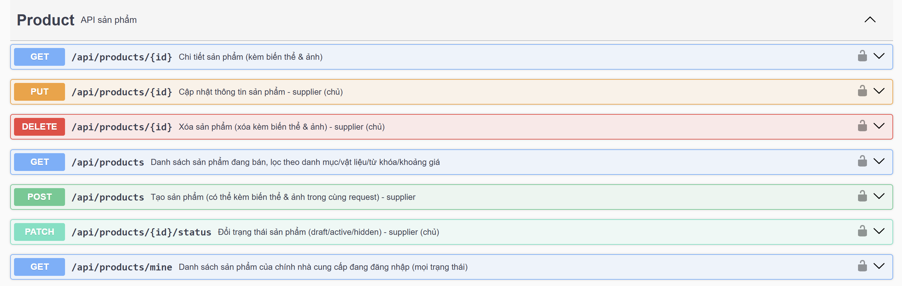

**Nguồn B49**

POST /products: thêm sản phẩm hoàn chỉnh gồm có:

**Nguồn B50**

Sản phẩm (bàn học, tủ giày,…)

**Nguồn B51**

Biến thể (variant) của sản phẩm (màu sắc, kích thước)

**Nguồn B52**

Ảnh của sản phẩm

**Nguồn B53**

Luồng gọi api:

**Nguồn B54**

Upload file ảnh từ máy (nhiều request, thường dùng cho FE thật)

**Nguồn B55**

Vì upload file phải là multipart/form-data và cần productId, nên bắt buộc tạo sản phẩm trước rồi mới đẩy ảnh.

**Nguồn B57**

Bước 1 — Tạo sản phẩm kèm biến thể (chưa có ảnh, để status: "draft"):

**Nguồn B59**

POST /api/products

**Nguồn B61**

{

**Nguồn B62**

"name": "Bàn gỗ sồi",

**Nguồn B63**

"categoryId": "uuid-danh-muc",

**Nguồn B64**

"status": "draft",

**Nguồn B65**

"variants": [

**Nguồn B66**

    { "sku": "BAN-SOI-120", "color": "Nâu", "dimensions": "120x60x75", "price": 2500000 },

**Nguồn B67**

    { "sku": "BAN-SOI-160", "color": "Nâu", "dimensions": "160x80x75", "price": 3200000 }

**Nguồn B68**

]

**Nguồn B69**

}

**Nguồn B71**

→ lấy id sản phẩm từ response.

**Nguồn B73**

Bước 2 — Upload lần lượt từng file ảnh (gọi N lần cho N ảnh):

**Nguồn B75**

POST /api/products/{productId}/images/upload

**Nguồn B76**

Content-Type: multipart/form-data

**Nguồn B78**

file=<binary> (bắt buộc)

**Nguồn B79**

primary=true|false (tùy chọn)

**Nguồn B80**

sortOrder=0 (tùy chọn)

**Nguồn B82**

File được đẩy lên qua FileStorageService.upload(file, "products"), backend tự sinh URL và lưu.

**Nguồn B83**

Ảnh đầu tiên của sản phẩm tự động là ảnh chính; hoặc gửi primary=true (sẽ tự gỡ primary của ảnh cũ).

**Nguồn B84**

Không truyền sortOrder → tự đẩy xuống cuối (max + 1).

**Nguồn B85**

⚠️ Endpoint này upload 1 file mỗi request. Với nhiều ảnh, FE cần gọi song song hoặc tuần tự nhiều lần.

**Nguồn B86**

Bước 3 (tùy chọn) — Đăng bán: sau khi đã có biến thể + ảnh:

**Nguồn B88**

PATCH /api/products/{id}/status

**Nguồn B89**

{ "status": "active" }

**Nguồn B90**

PATCH /status: cập nhật trạng thái của sản phẩm (draft,active,hidden)

**Nguồn B91**

Supplier quản lý các biến thể của sản phẩm

**Nguồn B92 — ảnh**

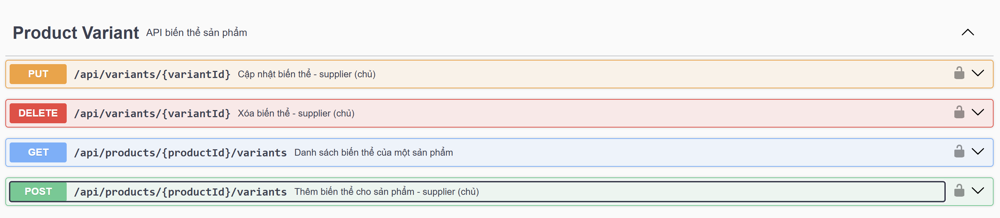

**Nguồn B93**

POST /variants: them biến thể vào sản phẩm nếu có cập nhật

**Nguồn B94**

Quản lý ảnh của sản phẩm

**Nguồn B95 — ảnh**

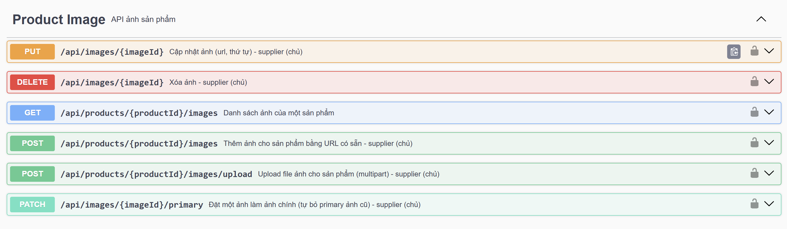

**Nguồn B96**

1. Mô hình dữ liệu ảnh

**Nguồn B97**

2. Ba nguyên lý bất biến FE cần nhớ

**Nguồn B98**

Backend tự đảm bảo 3 quy tắc sau, FE không cần tự tính mà chỉ cần hiểu để hiển thị đúng:

**Nguồn B99**

a) Mỗi sản phẩm chỉ có tối đa 1 ảnh primary. Đây là ràng buộc unique ở DB. Khi bạn đặt một ảnh làm primary, backend tự động gỡ primary của ảnh cũ. FE không cần gọi 2 request (bỏ ảnh cũ + set ảnh mới) — chỉ cần 1 request set-primary.

**Nguồn B100**

b) Ảnh đầu tiên của sản phẩm tự thành primary. Nếu sản phẩm chưa có ảnh nào, ảnh bạn thêm vào (dù không gửi primary) sẽ tự động là ảnh chính. Nên khi upload ảnh đầu tiên, FE không cần gửi primary=true.

**Nguồn B101**

c) sortOrder tự đẩy xuống cuối nếu không truyền. Không gửi sortOrder → backend lấy max hiện tại + 1, nên ảnh mới luôn nằm cuối, không trùng thứ tự. FE chỉ cần gửi sortOrder khi muốn chèn vào vị trí cụ thể.

**Nguồn B103**

Thứ tự sắp xếp khi GET: backend luôn trả về theo primary DESC → sortOrder ASC → createdAt ASC. Nghĩa là ảnh chính luôn nằm đầu danh sách, phần còn lại theo sortOrder. FE hiển thị theo đúng thứ tự mảng trả về là được, không cần sort lại.

**Nguồn B105**

3. Nguồn URL ảnh (backend lưu ở đâu)

**Nguồn B106**

Có 2 cách đưa ảnh vào hệ thống:

**Nguồn B107**

Upload file (/upload): FE gửi file nhị phân → backend đẩy lên Supabase Storage (bucket public) → tự sinh URL và lưu. Chỉ nhận JPEG, PNG, WEBP, GIF; file rỗng hoặc sai định dạng → 400.

**Nguồn B108**

Gắn URL có sẵn (POST .../images): dùng khi ảnh đã có link công khai từ nơi khác.

**Nguồn B109**

Với form upload từ máy người dùng, dùng cách upload file.

**Nguồn B111**

4. Danh sách 6 endpoint

**Nguồn B112**

Tất cả endpoint ghi (POST/PATCH/PUT/DELETE) yêu cầu token supplier là chủ sản phẩm; không phải chủ → 403. GET ảnh của sản phẩm chưa active cũng cần là chủ.

**Nguồn B114**

① Upload file ảnh — dùng nhiều nhất cho FE

**Nguồn B115**

POST /api/products/{productId}/images/upload

**Nguồn B116**

Content-Type: multipart/form-data

**Nguồn B117**

Form fields:

**Nguồn B118**

fieldbắt buộcý nghĩa

**Nguồn B119**

file✅file ảnh nhị phân

**Nguồn B120**

primary❌true để đặt làm ảnh chính (tự gỡ ảnh chính cũ)

**Nguồn B121**

sortOrder❌vị trí; bỏ trống = đẩy xuống cuối

**Nguồn B122**

→ 201 + object ảnh vừa tạo. Upload 1 file/request → nhiều ảnh phải gọi nhiều lần.

**Nguồn B124**

② Gắn ảnh bằng URL có sẵn

**Nguồn B125**

POST /api/products/{productId}/images

**Nguồn B126**

{ "url": "https://...", "primary": false, "sortOrder": 1 }

**Nguồn B127**

url bắt buộc. → 201 + object ảnh.

**Nguồn B129**

③ Lấy danh sách ảnh của sản phẩm

**Nguồn B130**

GET /api/products/{productId}/images

**Nguồn B131**

→ 200 + mảng ảnh đã sắp xếp sẵn (ảnh chính đầu tiên).

**Nguồn B133**

④ Đặt ảnh làm ảnh chính

**Nguồn B134**

PATCH /api/images/{imageId}/primary

**Nguồn B135**

Không có body. Backend tự gỡ primary của ảnh cũ. → 200 + ảnh vừa set.

**Nguồn B137**

⑤ Cập nhật ảnh (đổi URL / đổi thứ tự)

**Nguồn B138**

PUT /api/images/{imageId}

**Nguồn B139**

{ "url": "https://...", "sortOrder": 2 }

**Nguồn B140**

url bắt buộc (@NotBlank); sortOrder tùy chọn (bỏ trống = giữ nguyên). ⚠️ Endpoint này không đổi được primary — muốn đổi ảnh chính phải dùng ④.

**Nguồn B142**

⑥ Xóa ảnh

**Nguồn B143**

DELETE /api/images/{imageId}

**Nguồn B144**

→ 204 (no content).

**Nguồn B146**

Thêm sản phẩm vào chi nhánh (Store Inventory)

**Nguồn B147**

1. Mô hình dữ liệu tồn kho

**Nguồn B148**

Điểm cốt lõi: tồn kho không gắn với sản phẩm/biến thể trực tiếp, mà là giao điểm giữa (chi nhánh × biến thể).

**Nguồn B150**

Cửa hàng (Store) ──┐

**Nguồn B151**

                                  ├──> StoreInventory { stockQuantity }

**Nguồn B152**

     Biến thể (Variant) ┘

**Nguồn B154**

Một biến thể có thể tồn ở nhiều chi nhánh, mỗi chi nhánh giữ số lượng riêng.

**Nguồn B155**

Khóa chính là kép (store_id, variant_id) → mỗi cặp chỉ có đúng 1 bản ghi tồn kho. Đây là lý do có sự phân biệt giữa "thêm mới" và "điều chỉnh" (xem mục 3).

**Nguồn B156**

Vì vậy toàn bộ endpoint định danh bản ghi bằng 2 path param: {storeId} + {variantId}, không có id riêng cho bản ghi tồn kho.

**Nguồn B157**

StoreInventoryResponse trả về dữ liệu biến thể được nhúng sẵn (FE không cần join thêm):

**Nguồn B159**

{

**Nguồn B160**

"storeId": "uuid",

**Nguồn B161**

"variantId": "uuid",

**Nguồn B162**

"productId": "uuid", // biến thể này thuộc sản phẩm nào

**Nguồn B163**

"sku": "BAN-SOI-120",

**Nguồn B164**

"color": "Nâu",

**Nguồn B165**

"dimensions": "120x60x75",

**Nguồn B166**

"price": 2500000,

**Nguồn B167**

"stockQuantity": 30, // tồn hiện tại tại chi nhánh này

**Nguồn B168**

"createdAt": "...",

**Nguồn B169**

"updatedAt": "..." // đổi mỗi khi điều chỉnh tồn kho

**Nguồn B170**

}

**Nguồn B172**

2. Ba nguyên lý bất biến FE cần nhớ

**Nguồn B173**

a) Quyền sở hữu kiểm 2 lớp. Mọi thao tác đều yêu cầu supplier đang đăng nhập vừa sở hữu chi nhánh vừa sở hữu biến thể (qua sản phẩm). Sai một trong hai → 403. Không tồn tại → 404. FE nên chỉ cho thao tác trên chi nhánh/sản phẩm của chính supplier.

**Nguồn B175**

b) "Thêm mới" và "điều chỉnh" là hai việc khác nhau — không thể thay thế nhau.

**Nguồn B177**

Biến thể chưa có trong kho chi nhánh → phải POST (thêm mới). Nếu POST khi đã tồn tại → 409.

**Nguồn B178**

Biến thể đã có → phải PATCH (điều chỉnh). Nếu PATCH khi chưa tồn tại → 404.

**Nguồn B179**

FE cần biết trạng thái hiện tại để gọi đúng endpoint. Thông thường: lấy danh sách tồn kho của chi nhánh trước (④), biến thể nào chưa có trong danh sách thì dùng "thêm mới", đã có thì dùng "điều chỉnh".

**Nguồn B181**

c) Tồn kho không bao giờ âm. PATCH cộng delta vào tồn hiện tại; nếu kết quả < 0 → 400 kèm tồn hiện tại. FE nên chặn trước khi gửi (không cho xuất quá tồn).

**Nguồn B183**

3. Cơ chế xuất/nhập kho bằng delta

**Nguồn B184**

Điều chỉnh tồn kho không gửi số lượng tuyệt đối, mà gửi mức thay đổi (delta):

**Nguồn B186**

delta > 0 → nhập kho (ví dụ +50).

**Nguồn B187**

delta < 0 → xuất kho (ví dụ -10).

**Nguồn B188**

Backend tính tồn mới = tồn cũ + delta, atomic trong 1 transaction.

**Nguồn B189**

Lý do dùng delta thay vì set thẳng số: tránh race condition khi 2 thao tác xuất/nhập diễn ra gần nhau ghi đè lẫn nhau. Nếu FE muốn hiển thị ô "sửa số lượng thành X", cần tự tính delta = X - stockQuantity_hiện_tại rồi gửi.

**Nguồn B191**

4. Danh sách 5 endpoint

**Nguồn B192**

Tất cả yêu cầu token supplier là chủ.

**Nguồn B194**

① Danh sách tồn kho của một chi nhánh

**Nguồn B195**

GET /api/stores/{storeId}/inventory

**Nguồn B196**

→ 200 + mảng StoreInventoryResponse, sắp xếp createdAt DESC (mới thêm lên đầu). Dùng để render bảng tồn kho của một cửa hàng.

**Nguồn B198**

② Thêm biến thể vào chi nhánh (tồn ban đầu)

**Nguồn B199**

POST /api/stores/{storeId}/inventory/{variantId}

**Nguồn B200**

{ "stockQuantity": 30 }

**Nguồn B201**

stockQuantity bắt buộc, ≥ 0. Đã tồn tại → 409. → 201 + bản ghi.

**Nguồn B203**

③ Điều chỉnh tồn kho (nhập/xuất)

**Nguồn B204**

PATCH /api/stores/{storeId}/inventory/{variantId}

**Nguồn B205**

{ "delta": -10 }

**Nguồn B206**

delta bắt buộc (số nguyên, âm hoặc dương). Chưa tồn tại → 404; vượt tồn → 400. → 200 + bản ghi đã cập nhật.

**Nguồn B208**

④ Xóa bản ghi tồn kho

**Nguồn B209**

DELETE /api/stores/{storeId}/inventory/{variantId}

**Nguồn B210**

Không tồn tại → 404. → 204. (Gỡ hẳn biến thể khỏi kho chi nhánh, khác với đưa tồn về 0.)

**Nguồn B212**

⑤ Tồn kho tổng hợp của một biến thể trên tất cả chi nhánh

**Nguồn B213**

GET /api/variants/{variantId}/inventory

**Nguồn B214**

→ 200:

**Nguồn B215**

{

**Nguồn B216**

"variantId": "uuid",

**Nguồn B217**

"totalStock": 80, // tổng tồn trên mọi chi nhánh

**Nguồn B218**

"stores": [ StoreInventoryResponse, ... ] // chi tiết từng chi nhánh

**Nguồn B219**

}

**Nguồn B220**

Dùng cho màn "xem một biến thể đang có ở đâu, tổng bao nhiêu".

**Nguồn B221**

Chat real time

**Nguồn B222**

1. Kiến trúc tổng thể: REST + STOMP song song

**Nguồn B223 — ảnh**

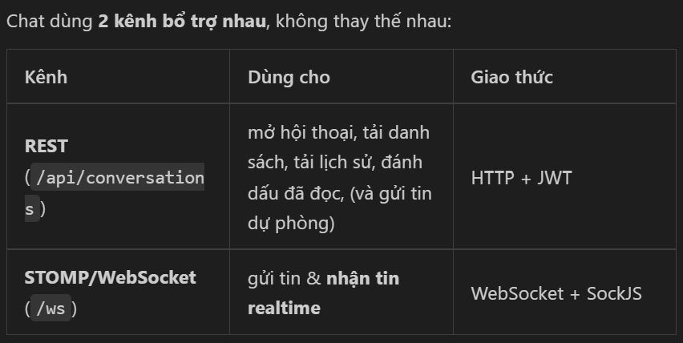

**Nguồn B224**

Nguyên lý: FE dùng REST để lấy dữ liệu tĩnh (mở màn hình, cuộn lịch sử), dùng WebSocket để gửi/nhận realtime. Một tin gửi qua STOMP vẫn được lưu DB (cùng logic ChatService.sendMessage), nên không mất tin.

**Nguồn B226**

⚠️ Điểm quan trọng: transport là STOMP over WebSocket, KHÔNG phải socket.io. FE phải dùng thư viện @stomp/stompjs (+ sockjs-client)

**Nguồn B228**

2. Mô hình dữ liệu

**Nguồn B229**

Conversation = 1 cặp (khách hàng × nhà cung cấp), duy nhất. ConversationResponse:

**Nguồn B231**

{

**Nguồn B232**

"id": "uuid",

**Nguồn B233**

"customerId": "uuid", "customerName": "Nguyễn A",

**Nguồn B234**

"supplierId": "uuid",

**Nguồn B235**

"supplierUserId": "uuid", // userId chủ NCC — dùng để tra presence

**Nguồn B236**

"supplierBusinessName": "Xưởng gỗ B",

**Nguồn B237**

"productId": "uuid|null", "productName": "...|null", // ngữ cảnh sản phẩm (tùy chọn)

**Nguồn B238**

"lastMessageAt": "...",

**Nguồn B239**

"customerLastReadAt": "...", "supplierLastReadAt": "...",

**Nguồn B240**

"unreadCount": 3, // chưa đọc theo góc nhìn người đang gọi API

**Nguồn B241**

"createdAt": "...", "updatedAt": "..."

**Nguồn B242**

}

**Nguồn B244**

Message (ChatMessageResponse):

**Nguồn B246**

{

**Nguồn B247**

"id": "uuid",

**Nguồn B248**

"conversationId": "uuid",

**Nguồn B249**

"senderId": "uuid", // dùng để FE phân biệt tin của mình

**Nguồn B250**

"senderName": "Nguyễn A",

**Nguồn B251**

"content": "text|null",

**Nguồn B252**

"attachmentUrl": "url|null",

**Nguồn B253**

"createdAt": "..."

**Nguồn B254**

}

**Nguồn B256**

3. Ba nguyên lý bất biến FE cần nhớ

**Nguồn B257**

a) Hội thoại là idempotent theo cặp (khách, NCC). Gọi "mở hội thoại" nhiều lần với cùng NCC → luôn trả về đúng 1 hội thoại cũ, không tạo trùng. FE cứ gọi mỗi khi khách bấm "Chat với người bán".

**Nguồn B259**

b) Nhận tin qua hàng đợi riêng từng người, không phải topic chung. Server đẩy tin tới /user/queue/messages — mỗi người chỉ nhận tin của các hội thoại mình tham gia (tránh nghe lén). FE subscribe đúng 1 đích /user/queue/messages là nhận được tin của mọi hội thoại; sau đó tự lọc theo conversationId để bỏ vào đúng khung chat.

**Nguồn B261**

c) Server echo lại tin cho cả người gửi. Khi bạn gửi tin, server đẩy về cho cả hai người (kể cả người gửi) để đồng bộ đa thiết bị/tab. Vì vậy:

**Nguồn B263**

FE không cần optimistic echo tự thêm tin vào UI — chờ tin từ WebSocket về rồi render (đảm bảo có id, createdAt thật).

**Nguồn B264**

Nếu vẫn muốn optimistic để mượt, phải khử trùng theo id khi tin thật về, và phân biệt tin của mình bằng senderId === myUserId để canh phải/trái.

**Nguồn B265**

4. Kết nối WebSocket (STOMP)

**Nguồn B266 — ảnh**

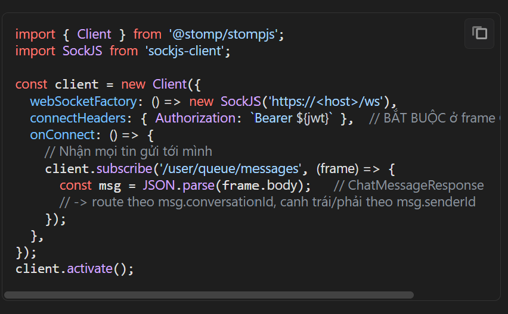

**Nguồn B267**

Điểm mấu chốt:

**Nguồn B269**

Token JWT gửi trong connectHeaders (frame CONNECT), không qua query string. Thiếu/sai token → server chặn kết nối ngay.

**Nguồn B270**

Endpoint /ws bật SockJS fallback nên phải dùng SockJS + webSocketFactory (không nối thẳng ws://).

**Nguồn B271**

principal = email được gắn sau CONNECT; toàn bộ định tuyến /user/... dựa vào đó.

**Nguồn B272**

Gửi tin qua STOMP:

**Nguồn B273 — ảnh**

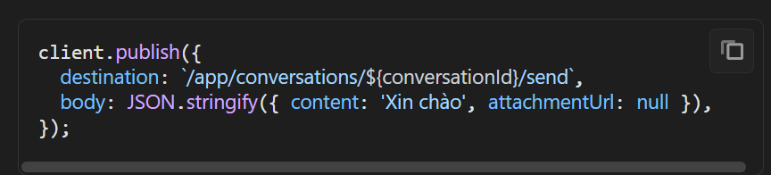

**Nguồn B274**

Không cần Authorization lại (đã xác thực ở CONNECT). Tin sẽ được lưu DB rồi đẩy về /user/queue/messages của cả hai bên.

**Nguồn B276**

5. Danh sách endpoint REST

**Nguồn B277**

Tất cả cần header Authorization: Bearer <JWT>.

**Nguồn B279**

① Mở / lấy lại hội thoại (khách hàng)

**Nguồn B280**

POST /api/conversations

**Nguồn B281**

{ "supplierId": "uuid", "productId": "uuid|null" }

**Nguồn B283**

NCC chưa active → 403; tự nhắn chính mình → 400. → 201 + ConversationResponse (đã tồn tại thì trả về cái cũ).

**Nguồn B285**

② Danh sách hội thoại của tôi

**Nguồn B286**

GET /api/conversations?role=customer|supplier&page=0&size=20

**Nguồn B288**

role=customer: hội thoại tôi là khách. role=supplier: hội thoại của cửa hàng tôi (tài khoản không phải NCC → 403). → Page<ConversationResponse> (có unreadCount theo đúng vai).

**Nguồn B290**

③ Lịch sử tin nhắn

**Nguồn B291**

GET /api/conversations/{conversationId}/messages?page=0&size=30

**Nguồn B293**

Trả mới nhất trước (createdAt DESC). FE thường reverse lại để hiển thị và dùng page tăng dần để cuộn ngược. Không phải người trong cuộc → 403.

**Nguồn B295**

④ Gửi tin (REST — dự phòng)

**Nguồn B296**

POST /api/conversations/{conversationId}/messages

**Nguồn B297**

{ "content": "...", "attachmentUrl": "..." }

**Nguồn B299**

Phải có ít nhất content hoặc attachmentUrl, nếu rỗng cả hai → 400. content tối đa 5000 ký tự. → 201 + tin. Dùng khi WebSocket chưa kết nối được; tin này cũng được broadcast realtime như qua STOMP.

**Nguồn B301**

⑤ Đánh dấu đã đọc

**Nguồn B302**

POST /api/conversations/{conversationId}/read

**Nguồn B304**

Cập nhật mốc đã đọc → unreadCount về 0 ở lần list sau. → 204. Lưu ý: người gửi tin tự động được coi là đã đọc tới thời điểm gửi, nên chỉ cần gọi mark-read cho phía người nhận khi họ mở khung chat.

**Nguồn B306**

⑥ Presence (online/offline)

**Nguồn B307**

GET /api/users/{id}/presence

**Nguồn B309**

→ { userId, online, lastSeenAt }. online=true → hiển thị "Đang hoạt động"; false → "Hoạt động ... trước" dựa vào lastSeenAt (null nếu chưa từng online). FE tra presence của đối phương bằng supplierUserId (khi mình là khách) hoặc customerId (khi mình là NCC).

**Nguồn B311**

online chỉ cập nhật khi có/mất phiên WebSocket. Nên muốn hiện đúng trạng thái, FE phải giữ kết nối /ws khi ở trong app; presence là polling qua REST (không có push), FE tự đặt nhịp gọi lại (ví dụ mỗi 30–60s khi đang mở khung chat).

**Nguồn B313**

6. Luồng FE điển hình

**Nguồn B314**

Khi vào app (đã đăng nhập):

**Nguồn B316**

Kết nối /ws (STOMP) + subscribe /user/queue/messages một lần, giữ suốt phiên.

**Nguồn B317**

GET /api/conversations?role=... (②) → render danh sách hội thoại + badge unreadCount.

**Nguồn B318**

Tin realtime đến (từ subscribe): route theo conversationId. Nếu đang mở đúng hội thoại đó → append vào khung + gọi ⑤ mark-read; nếu không → tăng badge chưa đọc trên danh sách.

**Nguồn B320**

Khi mở một khung chat:

**Nguồn B322**

GET .../messages (③) tải lịch sử (reverse để hiển thị cũ→mới).

**Nguồn B323**

POST .../read (⑤) đánh dấu đã đọc.

**Nguồn B324**

Tra GET /api/users/{đối_phương}/presence (⑥) hiển thị trạng thái online.

**Nguồn B325**

Khi gửi tin: ưu tiên client.publish qua STOMP; nếu WS đang mất kết nối, fallback POST .../messages (④). Tin của mình sẽ tự về qua subscribe → render (khử trùng theo id).

**Nguồn B327**

Khách bấm "Chat với người bán" ở trang sản phẩm: POST /api/conversations (①) với supplierId + productId → nhận conversationId → mở khung chat.
